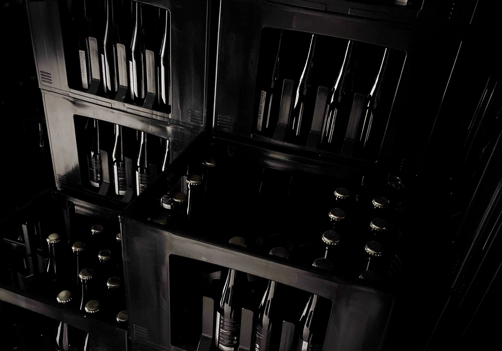
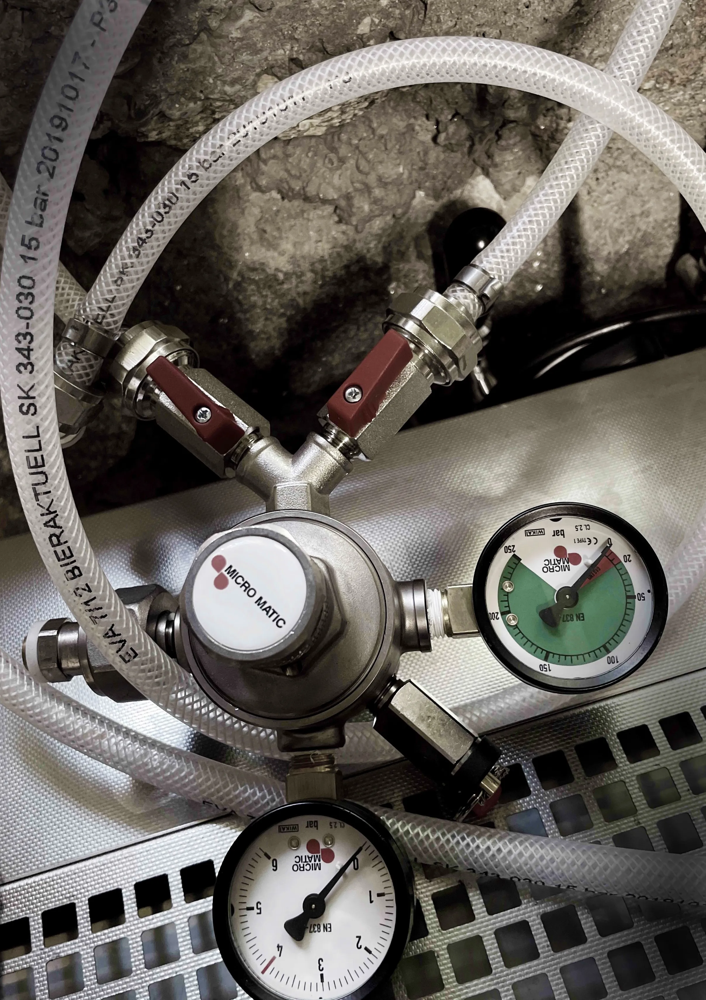
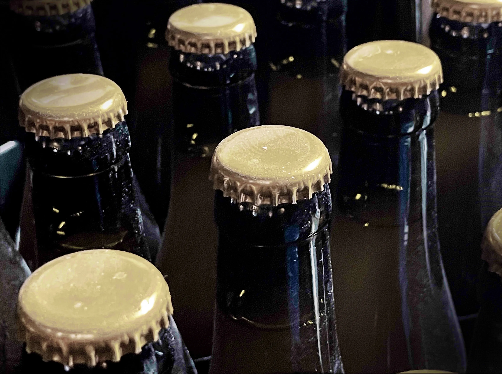

## Cinq bières, **une signature**

Avec un bagage belge et un ancrage conflentois, chaque recette est une conversation entre deux cultures brassicoles. De la blonde de soif à la bouteille de caractère.

<!--
  MODE D'EMPLOI DES CARTES
  - Pour changer une jauge : modifier le pourcentage dans style="--v:24%" (longueur de la barre) et le chiffre affiché à côté.
  - Pour ajouter une recette : remplacer <em>Recette à venir</em> par <a href="ADRESSE">Recette · CC0 1.0</a>.
  - Pour ajouter une bière : copier un bloc <article> ... </article> complet.
-->

<article class="carte">
<h4>La Josette</h4>

Golden Ale

Alc. 4,5 % vol.

Amertume <i style="--v:24%"></i> <b>24 IBU</b>
Couleur <i style="--v:7%"></i> <b>7 EBC</b>

<dl class="ingredients">

<dt>Malt</dt><dd>Pilsner, Pale Ale</dd>

<dt>Houblon</dt><dd>Magnum, Saaz</dd>

<dt>Levure</dt><dd>Ale US-05 Sèche</dd>

</dl>

Cette bière de style anglais utilise des houblons que l'on retrouve habituellement dans les pilsners allemandes et tchèques. Amertume nette et désaltérante avec une finale légèrement poivrée aux notes florales.

<a href="https://gitea.zaclys.com/auborddulit/Recettes/src/branch/main/Josette.md">Recette · CC0 1.0</a>

</article>

<article class="carte">
<h4>La Belle‑gitude</h4>

Belgian IPA

Alc. 6,7 % vol.

Amertume <i style="--v:77.5%"></i> <b>62 IBU</b>
Couleur <i style="--v:17%"></i> <b>17 EBC</b>

<dl class="ingredients">

<dt>Malt</dt><dd>Pale Ale, Amber, Caramunich III</dd>

<dt>Houblon</dt><dd>East Kent Goldings</dd>

<dt>Levure</dt><dd>LalBrew Belle Saison</dd>

</dl>

Sous-style de la très populaire IPA, la Belgian IPA est brassée avec une levure de type saison. Elle met l'accent sur l'accord entre les saveurs épicées de la levure et des houblons du vieux monde au caractère herbacé.

<a href="https://gitea.zaclys.com/auborddulit/Recettes/src/branch/main/LaBelleGitude.md">Recette · CC0 1.0</a>

</article>

<article class="carte">
<h4>L'Arôme Antique</h4>

Brut IPA

Alc. 6,1 % vol.

Amertume <i style="--v:27%"></i> <b>27 IBU</b>
Couleur <i style="--v:7%"></i> <b>7 EBC</b>

<dl class="ingredients">

<dt>Malt</dt><dd>Orge, Flocons de Maïs</dd>

<dt>Houblon</dt><dd>Hallertau Blanc</dd>

<dt>Levure</dt><dd>LalBrew BRY-97</dd>

</dl>

Volontairement neutre sur le malt et la levure, le houblon s'exprime pleinement avec une amertume contenue et une saveur fruitée aux notes vineuses de groseille et d'herbe.

<em>Recette à venir</em>

</article>

<article class="carte">
<h4>La Wheat‑6</h4>

Wheatwine

Alc. 8,6 % vol.

Amertume <i style="--v:52%"></i> <b>52 IBU</b>
Couleur <i style="--v:10%"></i> <b>10 EBC</b>

<dl class="ingredients">

<dt>Malt</dt><dd>Orge, Pilsen, Blé + sucre</dd>

<dt>Houblon</dt><dd>Magnum, Hallertau Blanc</dd>

<dt>Levure</dt><dd>Ale US-05 Sèche</dd>

</dl>

Forte et vineuse, brassée sur une base de froment. Un style rare et puissant — à siroter entre amis.

<em>Recette à venir</em>

</article>

<article class="carte">
<h4>La Larme Blanche</h4>

Berliner Weisse

Alc. 3,3 % vol.

Amertume <i style="--v:24%"></i> <b>24 IBU</b>
Couleur <i style="--v:7%"></i> <b>7 EBC</b>

<dl class="ingredients">

<dt>Malt</dt><dd>Orge Pilsen, Malt de blé</dd>

<dt>Houblon</dt><dd>Hallertau Blanc + zestes</dd>

<dt>Levure</dt><dd>Lalbrew Philly Sour</dd>

</dl>

Une bière de blé à la mode berlinoise. Une fermentation lactique complémentaire apporte une acidité désaltérante. Agrémentée de zestes d'agrumes, elle se démarque des bières conventionnelles.

<em>Recette à venir</em>

</article>

