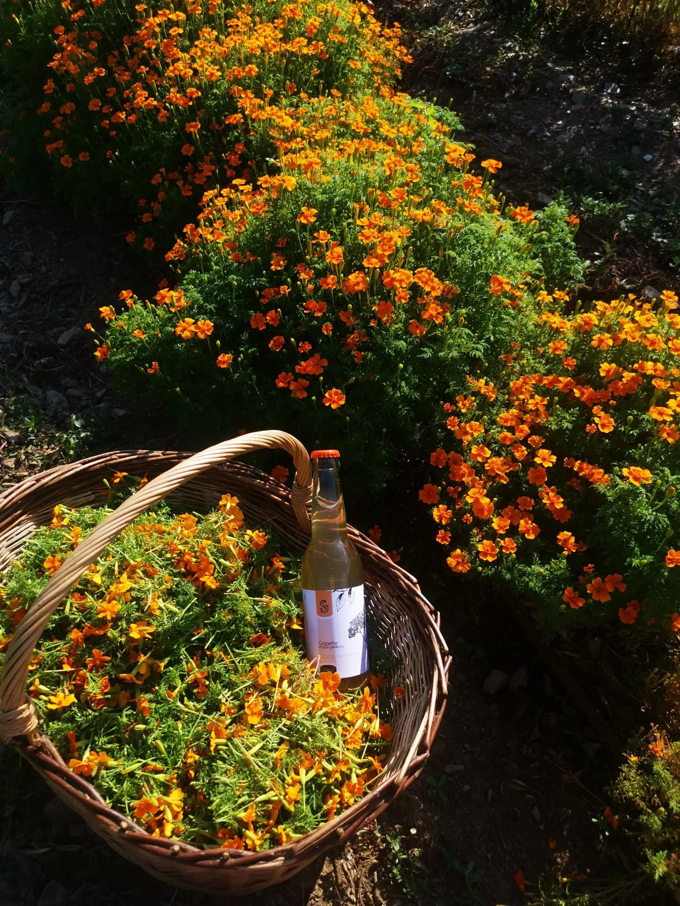
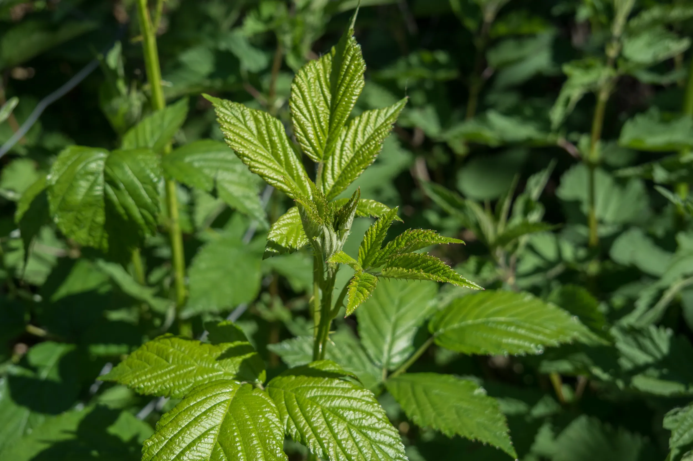

## Infusions pétillantes, **les Gazettes**

Pensées pour les adultes, les Gazettes sont des boissons désaltérantes pauvres en sucre (4 g/100 ml). Infusions de plantes aromatiques aux notes taniques, acidifiées, légèrement sucrées et gazéifiées au CO₂.

<article class="carte">
<h4>Tagète 'Mandarine' &amp; Ronce</h4>

Tagète 'Mandarine' · Ronce

La fraîcheur de l'agrume sans zeste, grâce à la fleur de Tagète cultivable dans nos jardins, équilibrée par l'astringence de la ronce.

</article>

<article class="carte">
<h4>Menthe 'Bergamote' &amp; Framboisier</h4>

Menthe 'Bergamote' · Framboisier

La délicatesse de la bergamote et la vivacité de la menthe, pour l'évocation d'un thé glacé maison.

</article>

<article class="carte">
<h4>Sureau, Cassissier &amp; Ronce</h4>

Fleur de Sureau · Cassissier · Ronce

La limonade de sureau réinventée, plus profonde et complexe, avec des notes taniques et boisées.

</article>

