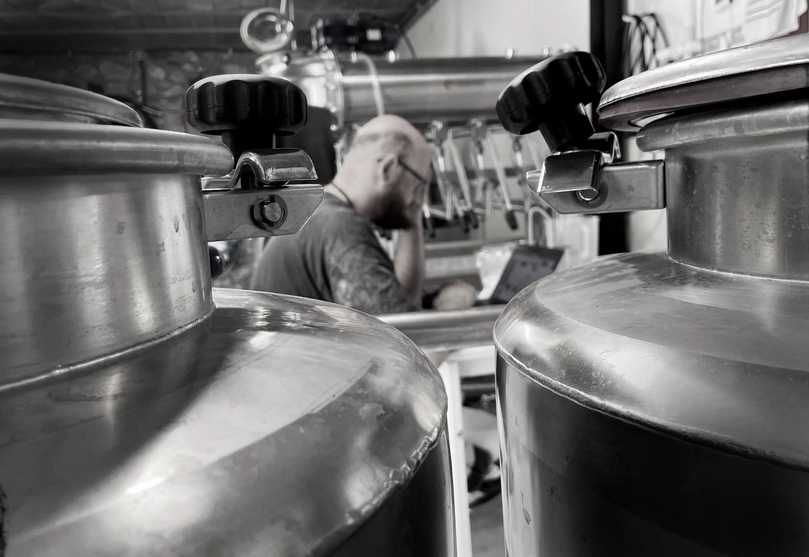

<section class="hero pleine-largeur">

Brasserie artisanale · Fillols, Conflent · P.-O.

<h1 class="hero-titre">la brasserie <strong>au bord du lit</strong></h1>

Une brasserie conflentoise de proximité, née d'une reconversion. Des bières inspirées de la culture belge, ancrées dans les Pyrénées-Orientales.

Bouteilles consignées
Caisses réutilisables
Compostage sur site
Livraison à vélo cargo
Open Source

<a class="bouton-noir" href="bieres.html">Découvrir nos produits</a>

<figure class="hero-photo">

<figcaption>Juste une brasserie, rurale et villageoise.<strong>Fillols</strong></figcaption>
</figure>
</section>

## Nos <strong>produits</strong>

Avec un bagage belge et un ancrage conflentois, chaque recette est une conversation entre deux cultures brassicoles.

<a class="carte" href="bieres.html">
<h4>Les bières</h4>

Cinq recettes, de la blonde de soif à la bouteille de caractère.

Voir la gamme →
</a>
<a class="carte" href="gazettes.html">
<h4>Les Gazettes</h4>

Infusions pétillantes sans alcool, pauvres en sucre, pensées pour les adultes.

Voir les Gazettes →
</a>
<a class="carte" href="nous%20trouver.html">
<h4>Nous trouver</h4>

Bars, restaurants et épiceries du Conflent, et vente directe à la brasserie.

Voir les points de vente →
</a>

